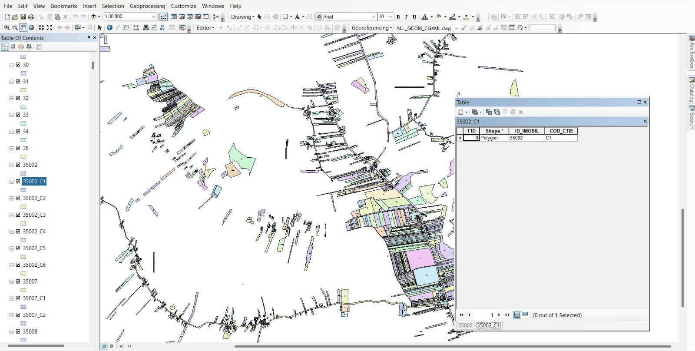
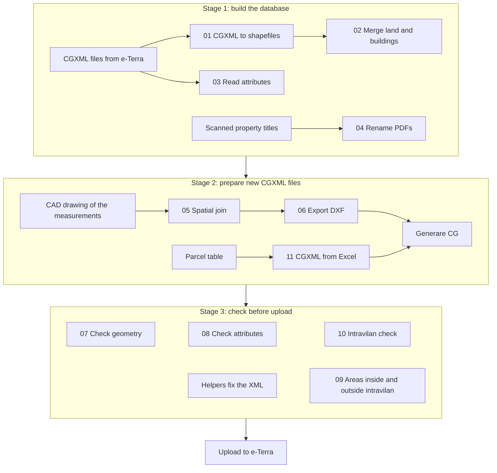
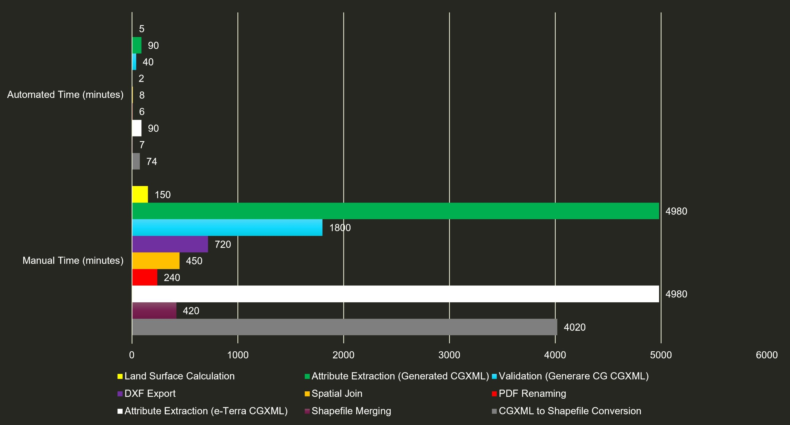

# ArcPy Cadaster Tools

ArcMap toolboxes and Python scripts that automate the repetitive parts of Romanian systematic cadaster work (cadastru general).

In a systematic cadaster project every property is a CGXML file: the land, its buildings, the owners, the deeds and the boundary coordinates, all in one XML file. One administrative unit easily means more than a thousand of these files, downloaded from e-Terra or produced with the ANCPI program Generare CG. On top of that come scanned property titles, CAD drawings of new measurements and a long list of checks before anything can be uploaded.

These tools do that work in batches. They turn CGXML files into shapefiles and attribute tables, join CAD drawings with their labels, export DXF files, rename scanned documents, calculate areas and fix common problems in Generare CG output. The manual time goes into decisions and quality control instead of copying values by hand.

This is a real project in ArcMap, with the land and buildings read from 1,642 e-Terra CGXML files by [tool 01](tools/01-eterra-cgxml-to-shapefiles):



## What is inside

| # | Tool | What it does | Runs in |
|---|------|--------------|---------|
| 01 | [e-Terra CGXML to shapefiles](tools/01-eterra-cgxml-to-shapefiles) | Turns every CGXML file downloaded from e-Terra into a land shapefile plus one shapefile per building, with the land ID and construction code. | ArcMap |
| 02 | [Merge land and buildings](tools/02-merge-land-and-buildings) | Merges thousands of single shapefiles into one Land layer and one Buildings layer. | ArcMap |
| 03 | [e-Terra CGXML attributes](tools/03-eterra-cgxml-attributes) | Reads parcels, areas, deeds, owners and notes from every e-Terra CGXML file into one polygon layer, so the legal data can be checked in a table. | ArcMap |
| 04 | [Rename PDFs from Excel](tools/04-rename-pdfs-from-excel) | Renames scanned property titles to the property ID (and land book number) from an Excel list. Copes with "6/1", "6 - 1" and "6-1" style names. | Python 3 |
| 05 | [Multiple spatial join](tools/05-multiple-spatial-join) | Links CAD polygons with their text labels: land IDs to land, construction codes to buildings, then every building to the land it stands on. | ArcMap |
| 06 | [Export DXF](tools/06-export-dxf) | Exports every property or building to its own DXF file, named after one or two attribute fields, ready for Generare CG. | ArcMap |
| 07 | [Generare CG CGXML to shapefiles](tools/07-generare-cg-cgxml-to-shapefiles) | Same as 01 for files made with Generare CG, to check the geometry before upload. | ArcMap |
| 08 | [Generare CG CGXML attributes](tools/08-generare-cg-cgxml-attributes) | Same as 03 for files made with Generare CG, with deeds, owners, rights and quotas, to check the legal data before upload. | ArcMap |
| 09 | [Surface calculator](tools/09-surface-calculator) | Splits the area of every property into the part inside and the part outside the built up area (intravilan). | ArcMap |
| 10 | [Intravilan check](tools/10-intravilan-check) | Builds one layer from Generare CG files with a field that shows whether a property has any parcel inside the built up area. | ArcMap |
| 11 | [Generate CGXML from Excel](tools/11-generate-cgxml-from-excel) | Creates draft CGXML files straight from a parcel table (title number, owners, use category, area). | Python 3 |
| | [Helpers](helpers) | Small fixes for common Generare CG output problems, and a report of CGXML files that have no geometry. | Python |

## Where each tool fits



## Time saved

Measured on real projects, comparing the same task done by hand and with the tools:



| Task | By hand | With the tools |
|------|---------|----------------|
| Convert 1,000 e-Terra CGXML files to shapefiles | about 67 hours | 1 h 14 min |
| Merge 2,000 land and building shapefiles | about 7 hours | 7 min |
| Read the attributes of 1,000 e-Terra CGXML files into one table | about 83 hours | 1 h 30 min |
| Rename 500 scanned property titles | about 4 hours | 6 min |
| Spatial joins for 5 cadastral sectors | about 7.5 hours | 8 min |
| Export 800 DXF files | about 12 hours | 2 min |
| Check the geometry of 1,000 Generare CG files | about 30 hours | 40 min |
| Read the attributes of 1,000 Generare CG files into one table | about 83 hours | 1 h 30 min |
| Areas inside and outside intravilan for 5 sectors | about 2.5 hours | 5 min |
| **All nine tasks together** | **about 296 hours** | **5 h 22 min** |

The tools also remove a whole class of mistakes: mistyped coordinates, files skipped by accident and IDs linked to the wrong parcel.

## Requirements

* **ArcMap 10.4 or later with ArcPy** (Python 2.7) for tools 01, 02, 03, 05, 06, 07, 08, 09 and 10. They were built and used in ArcMap. Most of the code should also run in ArcGIS Pro, but that has not been tested.
* **Tool 09** uses the Erase tool, which in ArcMap needs an ArcGIS Desktop Advanced license.
* **Python 3** with `pandas` and `openpyxl` for tool 04 and the folder comparison helper, plus `lxml` for tool 11:

  ```
  pip install pandas openpyxl lxml
  ```

All coordinates are handled in the Romanian national system Stereo 70 (EPSG:31700).

## Quick start

1. Download the repository (**Code > Download ZIP**) or clone it.
2. In ArcMap, open **ArcToolbox**, right click it, choose **Add Toolbox** and pick the `.tbx` file in a tool folder.
3. Right click the tool, open **Properties > Source** and point **Script File** to the `.py` file in the same folder. The toolboxes still remember the folder they were created in on the original computer.
4. Run the tool on the files in [sample_data](sample_data).

[docs/setup.md](docs/setup.md) has the same steps in more detail, with screenshots, plus how to run the standalone Python scripts.

## Sample data

Everything in [sample_data](sample_data) is made up. The files keep the structure of real CGXML files, so every tool can be tried on them. Every name, personal ID number (CNP), address, land book, cadastral, title and deed number, date and authority was replaced with fictional values, and all parcels were moved to a different location. See [sample_data/README.md](sample_data/README.md).

The screenshots come from real projects. Owner names, personal notes, deed and title numbers, administrative unit codes and the folder and layer names that show the place are blurred, and the map coordinates are cropped out.

## License

MIT, see [LICENSE](LICENSE). You are free to use, change and share the code, as long as the copyright notice stays with it.

## Author

Fabian Beșca, GIS and Remote Sensing specialist. Built while working on Romanian systematic cadaster projects.
