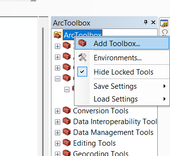
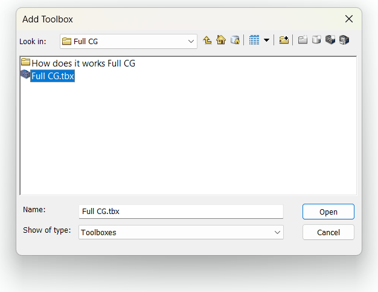
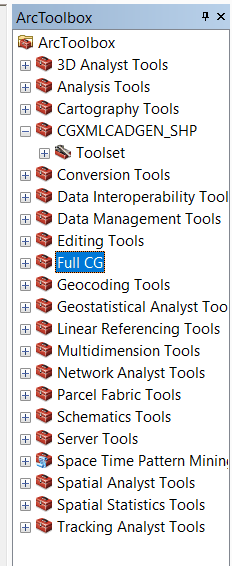
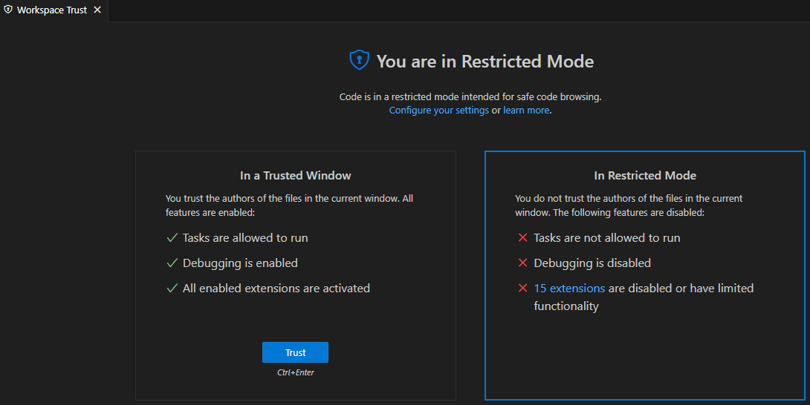
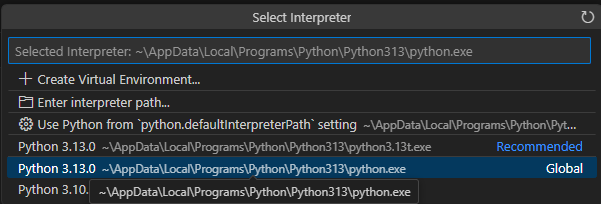

# Setup

## ArcMap toolboxes

### Add a toolbox

1. Open ArcMap.
2. Open the **ArcToolbox** window (**Geoprocessing > ArcToolbox**).
3. Right click **ArcToolbox** at the top of that window (not in the Catalog) and choose **Add Toolbox**.
4. Find the `.tbx` file in the tool folder, select it and click **Open**.
5. The toolbox now appears in the list. Expand it to see the tool.

  
  
  

### Point the tool to its script

The toolboxes were made on another computer and still remember the folder the script was in there. Do this once for every tool:

1. Right click the tool and choose **Properties**.
2. Open the **Source** tab.
3. Set **Script File** to the `.py` file in the same folder as the toolbox.
4. Click **OK**.

The tool now opens like any other ArcMap tool.

### A tip on folders

Some tools ask for an output folder as typed text, not with a browse button. Type or paste the full path, and create the folder first when the tool page says so.

## Standalone Python scripts

Tool 04, tool 11 and `helpers/Separare.py` run without ArcGIS, on Python 3:

1. Install Python 3 from [python.org](https://www.python.org/downloads/).
2. Install the packages: `pip install pandas openpyxl lxml`
3. Open the script, set the paths at the top (or at the bottom for the helpers) and run it.

The XML helpers (`Add0.py`, `Remove field.py`, `TITLE.py`, `Intab_Poss_Art.py`) only use the Python standard library and run on Python 2 or 3.

### Running scripts from Visual Studio Code

1. Install [Visual Studio Code](https://code.visualstudio.com/download) and its Python extension.
2. Open the repository folder. If VS Code asks whether you trust the authors of the files, choose **Trust**.

   

3. Press `Ctrl+Shift+P`, run **Python: Select Interpreter** and pick:
   * your normal Python 3 for scripts that do not use `arcpy`
   * the Python that came with ArcMap for scripts that use `arcpy` (usually in `C:\Python27\ArcGIS10.x`)

   

Scripts that read tool parameters with `arcpy.GetParameterAsText` are meant to run as ArcMap tools. Run those from the toolbox.
