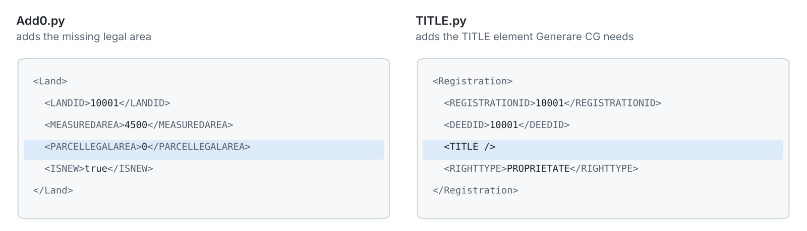

# Helpers

Small scripts for problems that came up again and again in real projects, mostly in the output of Generare CG. Each one works on a whole folder at once. Set the folder path at the bottom of the script, then run it with Python.

The four XML scripts change the files **in place** and only read files whose name ends in `.CGXML` (upper case, as Generare CG writes them). Keep a copy of the folder before running them.

| Script | What it does | Why |
|--------|--------------|-----|
| `Add0.py` | Adds `<PARCELLEGALAREA>0</PARCELLEGALAREA>` right after `<MEASUREDAREA>` in every land record that has no legal area. | Without a legal area, the cadastral register of properties cannot be generated. |
| `Remove field.py` | Removes `PARCELLEGALAREA` when its value is `0`. | e-Terra does not accept 0 as a legal area. Run it after the register has been generated. |
| `TITLE.py` | Makes sure every registration has a `<TITLE>` element right after `<DEEDID>`. | Generare CG cannot export a file when that element is missing. |
| `Intab_Poss_Art.py` | Marks deeds number 7 (Law 7/1996) as `ACT_NORMATIV`, turns registrations based on them into possession registrations (`POSESION_REGISTATION`, ownership, law, quota 1/1), and adds the unidentified owner note to notations of owners named `NEIDENTIFICAT`. | Prepares possession registrations for unidentified owners the way e-Terra expects them. Note that it sets the notes of every deed in a file to `art.13, alin.14, alin.15`, so use it on the files that need it. |
| `Separare.py` | Compares a folder of CGXML files with a folder of shapefiles by file name and writes an Excel report of names found in both and names missing from one of them. It reads files ending in lower case `.cgxml`, as e-Terra names them. | With more than 2,000 files, it shows quickly which CGXML files have no geometry. Needs `pip install pandas openpyxl`. |

<picture>
  <source media="(prefers-color-scheme: dark)" srcset="../docs/images/helpers_fixes-dark.png">
  
</picture>

## Try them

Copy `sample_data/generare_cg_cgxml` and point the XML scripts to the copy. For `Separare.py`, compare `sample_data/eterra_cgxml` with the shapefile folder made by [tool 01](../tools/01-eterra-cgxml-to-shapefiles).
