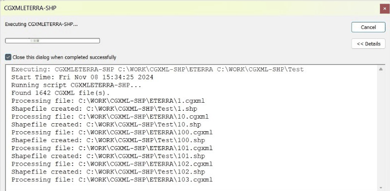

# 01 e-Terra CGXML to shapefiles

Turns every CGXML file downloaded from e-Terra into shapefiles: one for the land and one for each building on it. This makes the geometry of a whole administrative unit visible in ArcMap in one run.

This is the result on a real project, where 1,642 CGXML files became one shapefile per land and per building:

**Files:** `CGXML_IE-SHP.py` (script), `CGXMLIE_SHP.tbx` (toolbox, tool name `CGXMLETERRA-SHP`)

## Parameters

This is the tool in ArcMap:

| Parameter | What to give it |
|-----------|-----------------|
| Input_CGXML_Folder | Folder with the `.cgxml` files from e-Terra. ArcMap does not show `.cgxml` files in the browse dialog, so the folder can look empty. That is normal. |
| Output_SHP_Folder | Folder for the new shapefiles. Type or paste the path, and create the folder first. |

While it runs, the window lists every file it reads and every shapefile it creates:

## Output

* One shapefile per land, named after its e-Terra ID (`E2IDENTIFIER`), with the field `ID`.
* One shapefile per building, named `<land ID>_<construction code>` (for example `50101_C1.shp`), with the fields `ID_IMOBIL` (the land it stands on) and `COD_CTIE` (the construction code).
* All in Stereo 70 (EPSG:31700). Dashes in IDs become underscores in file names.

Land and buildings without coordinates are skipped.

## Try it

Run it on `sample_data/eterra_cgxml`. You get 13 land shapefiles and 17 building shapefiles. Then merge them with [tool 02](../02-merge-land-and-buildings).
