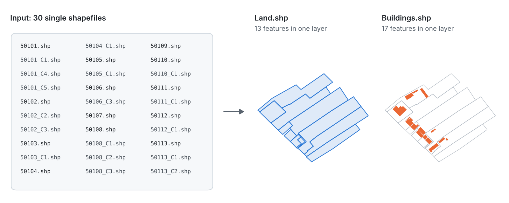
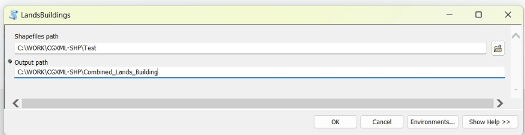

# 02 Merge land and buildings

A whole administrative unit gives thousands of single shapefiles. This tool merges them into two layers: `Land.shp` and `Buildings.shp`.

<picture>
  <source media="(prefers-color-scheme: dark)" srcset="../../docs/images/tool02_merge-dark.png">
  
</picture>

**Files:** `Combined_Lands_Building.py` (script), `Combining_Land_Buildings.tbx` (toolbox, tool name `LandsBuildings`)

## Parameters

This is the tool in ArcMap:

| Parameter | What to give it |
|-----------|-----------------|
| Shapefiles path | The folder made by [tool 01](../01-eterra-cgxml-to-shapefiles) or [tool 07](../07-generare-cg-cgxml-to-shapefiles). |
| Output path | Folder for the two merged layers. It is created if it does not exist. |

## How it tells land from buildings

Building shapefiles have an underscore in their name (`50101_C1.shp`), land shapefiles do not (`50101.shp`). That is the naming used by tools 01 and 07. The attribute fields are kept, so `Land.shp` has the land IDs and `Buildings.shp` has the land ID and construction code of every building.

## Try it

Run tool 01 on `sample_data/eterra_cgxml`, then run this tool on its output folder. `sample_data/shapefiles/Land.shp` and `Buildings.shp` show what the result looks like.
