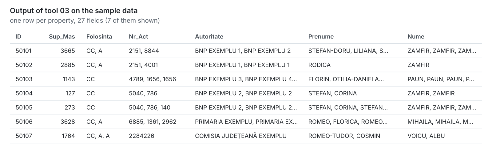
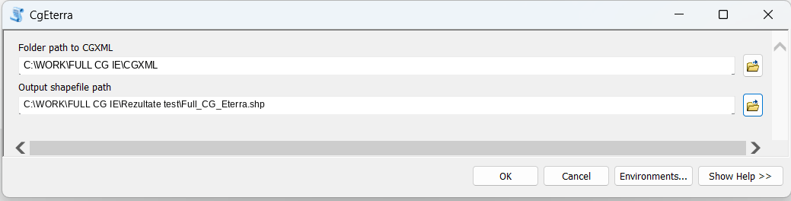

# 03 e-Terra CGXML attributes

Checking geometry is not enough. This tool reads the legal and technical data of every e-Terra CGXML file (parcels, areas, deeds, registrations, owners, notes) and puts it into one polygon layer, one row per property. The table can then be sorted, filtered or exported to Excel for checking.

<picture>
  <source media="(prefers-color-scheme: dark)" srcset="../../docs/images/tool03_attributes-dark.png">
  
</picture>

**Files:** `Full CG IE.py` (script), `FULL CG IE.tbx` (toolbox, tool name `CgEterra`)

## Parameters

This is the tool in ArcMap:

| Parameter | What to give it |
|-----------|-----------------|
| Folder path to CGXML | Folder with the `.cgxml` files from e-Terra. |
| Output shapefile path | The new shapefile, for example `C:\work\eterra_attributes.shp`. |

## Fields in the output

When a property has several parcels, deeds or owners, the values are listed with commas, in the order they appear in the CGXML file.

| Field | Content | Field | Content |
|-------|---------|-------|---------|
| ID | e-Terra ID (E2IDENTIFIER) | Nr_Act | Deed numbers |
| SIRSUP | Administrative unit code | Tip_Act | Deed types |
| Siruta | Locality code | Autoritate | Authorities that issued the deeds |
| IntrExtr | Inside the built up area (intravilan) | Tip_Inscr | Registration types |
| Sector | Cadastral sector | Obs_Ins | Registration notes |
| Sup_Mas | Measured area | Titlu_Ins | Registration titles |
| Sup_Acte | Area in the documents | Cota | Quota types |
| Nou | New property | Parte | Land book part |
| Imprejmuit | Fenced | Prenume | Owner first names |
| SupMasP | Measured area of each parcel | Nume | Owner last names |
| Folosinta | Use category of each parcel | Mort | Owner deceased |
| IntrExtrP | Intravilan status of each parcel | Obs_Imobil | Property notes |
| TitluP | Property title numbers | Tarla | Tarla (plot) numbers |
| Parcela | Parcel numbers | | |

Text longer than the field (50 or 250 characters) is cut. The tool warns about duplicate IDs and files without geometry.

## Try it

Run it on `sample_data/eterra_cgxml`. You get one layer with 13 properties.
