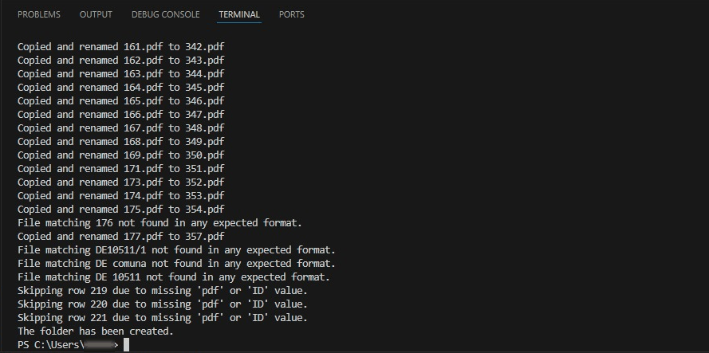
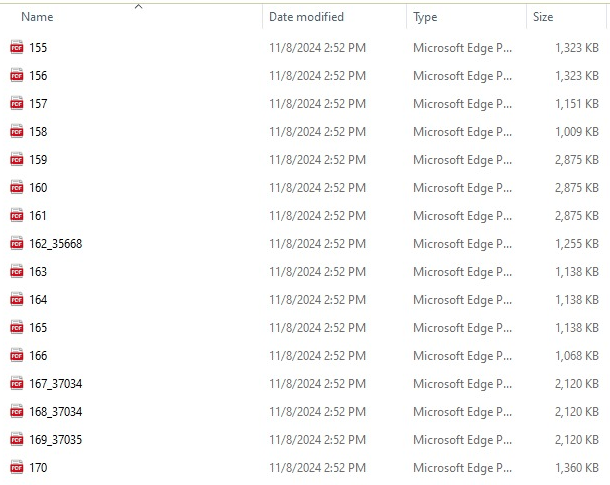

# 04 Rename PDFs from Excel

Scanned property titles usually arrive named after the title number (`6 - 1.pdf`, `13.pdf`). For the final delivery they must be named after the property ID. These scripts do the renaming from an Excel list, for hundreds of files at once.

This is a real run in the VS Code terminal. Every file that was found is copied with its new name, and every row that could not be matched is listed:

**Files:**

* `PDF to ID.py` names each file `<ID>.pdf`.
* `PDF to ID to NR CF.py` names each file `<ID>_<NR CF>.pdf` when a land book number is given, and `<ID>.pdf` when it is not.

Both are plain Python 3 scripts (no ArcGIS needed).

## The Excel list

| pdf | ID | NR CF |
|-----|----|-------|
| 103/1 | 50103 | |
| 103/2 | 50104 | 50104 |

* `pdf` is the name of the scanned file without `.pdf`. A slash is matched against file names with a dash, with or without spaces: `103/1` finds `103-1.pdf`, `103 -1.pdf`, `103- 1.pdf` or `103 - 1.pdf`.
* `ID` is the new name.
* `NR CF` is only used by `PDF to ID to NR CF.py`.

## How to run

1. Install the packages once: `pip install pandas openpyxl`
2. Open the script and set the three paths at the top: the folder with the PDFs, the Excel file and the folder for the renamed copies.
3. Run the script and type the name of the Excel sheet when it asks.

The original files are not touched. Renamed copies go into the new folder, which is created if needed. Rows with no `pdf` or `ID` value are skipped, and `PDF to ID.py` lists any file it could not find.

These are renamed copies from another real run, made with `PDF to ID to NR CF.py`. Files with a land book number have it after the ID:

## Try it

Point the paths to `sample_data/rename_pdfs/PDF init` and `sample_data/rename_pdfs/pdf_list.xlsx`, and use the sheet name `Sheet1`. All 8 sample files are renamed.
