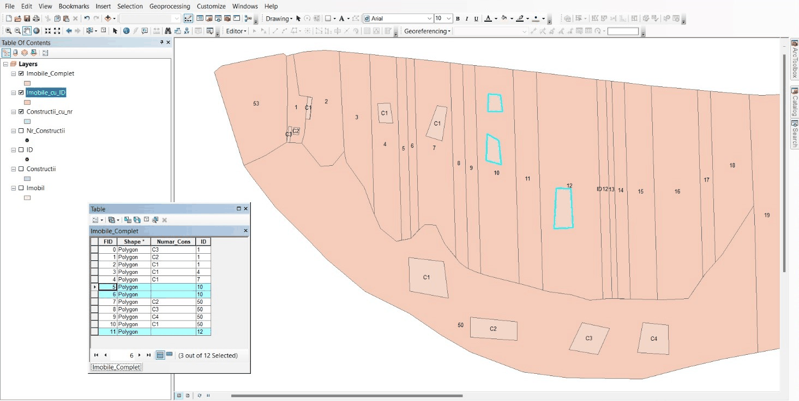
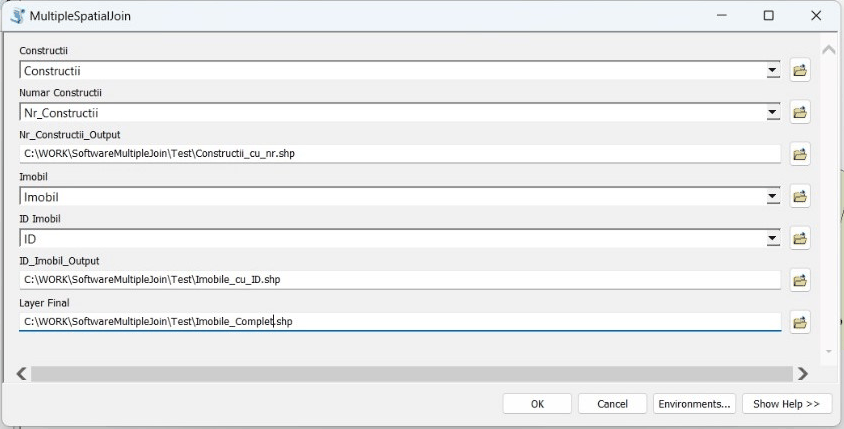

# 05 Multiple spatial join

New measurements are usually drawn in AutoCAD or a similar program. A drawing keeps the shapes, but the land IDs and construction codes are only text labels placed inside them. This tool turns the labels into attributes with three spatial joins, so every building knows its construction code and the ID of the land it stands on. That is what Generare CG needs.

This is the result on a real drawing: the buildings with their construction codes and the IDs of the land they stand on. The three selected rows have no code, so their label is missing in the drawing. The map shows which buildings they are:

**Files:** `FullJoin.py` (script), `SoftwareMultipleJoin.tbx` (toolbox, tool name `MultipleSpatialJoin`)

## Parameters

This is the tool in ArcMap:

| Parameter | What to give it |
|-----------|-----------------|
| Constructii | Building polygons. |
| Numar Constructii | Points with the construction codes (C1, C2...). |
| Nr_Constructii_Output | Output: buildings with their codes. |
| Imobil | Land polygons. |
| ID Imobil | Points with the land IDs. |
| ID_Imobil_Output | Output: land with its IDs. |
| Layer Final | Output: buildings with their code and the ID of their land. |

## What it does

1. Buildings get the code of the label point inside them (intersect).
2. Land gets the ID of the label point inside it (intersect).
3. Every building gets the land it lies within, so the final layer holds the building, its code and its land ID.

The first two joins keep every shape, even one without a label. The last join keeps only the buildings that lie within a land parcel. A shape with two labels inside it appears twice in the result, which makes that kind of drawing mistake easy to spot.

## Try it

Use the files in `sample_data/shapefiles`: `Constructii.shp`, `Nr_Constructii.shp`, `Imobile.shp` and `ID_Imobile.shp`. The labels are in the `Text` field, the same way they come out of a CAD export.
