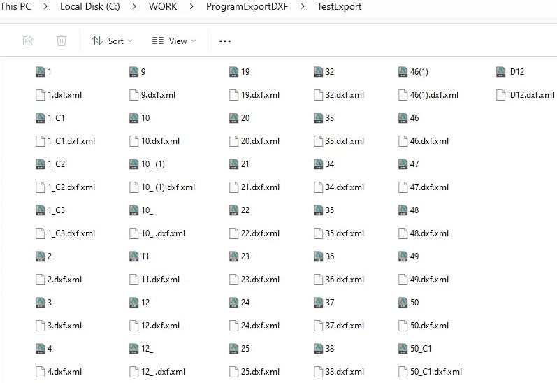
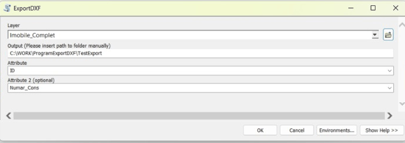
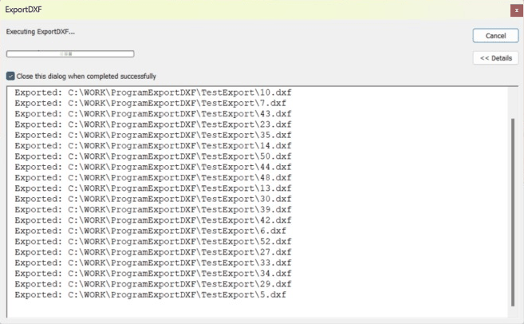

# 06 Export DXF

Generare CG takes the geometry of every property and building as a separate DXF file. Exporting them one by one from a CAD program takes about a minute each. This tool exports all of them in one run and names every file after the attribute values you choose.

This is the result on a real project. Every property and every building became its own DXF file, named after the ID and the construction code:

**Files:** `FinalProgram.py` (script), `SoftwareExportDXF.tbx` (toolbox, tool name `ExportDXF`)

## Parameters

This is the tool in ArcMap:

| Parameter | What to give it |
|-----------|-----------------|
| Layer | The polygon layer to export. |
| Output | Folder for the DXF files. Type or paste the path. It is created if it does not exist. |
| Attribute | Field used for the file name, for example `ID`. |
| Attribute 2 | Optional second field. The file name becomes `<value 1>_<value 2>.dxf`. |

While it runs, the window lists every file it exports:

## Details

* One DXF file (AutoCAD 2010 format) per feature.
* Characters Windows does not allow in file names are removed, and names are cut at 100 characters.
* If a name is already taken, the next file gets `(1)`, `(2)` and so on, for example `50101(1).dxf`.
* The naming fields should be text fields, because the tool selects features by comparing text values.

## Try it

* `sample_data/shapefiles/Land.shp` with Attribute `ID` gives `50101.dxf`, `50102.dxf` and so on.
* `sample_data/shapefiles/Buildings.shp` with `ID_IMOBIL` and `COD_CTIE` gives `50101_C1.dxf` and so on.
