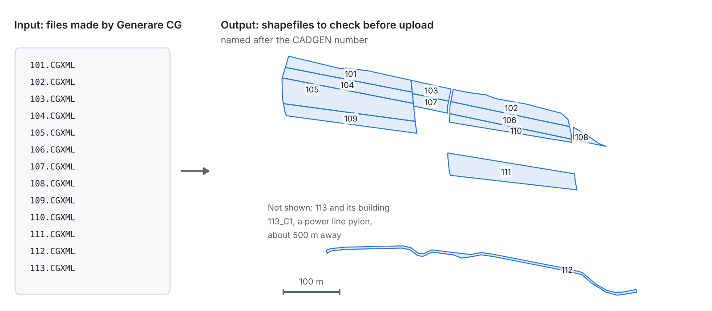
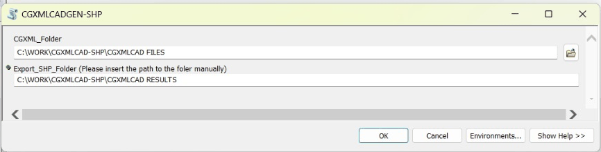

# 07 Generare CG CGXML to shapefiles

Generare CG, the ANCPI program that creates CGXML files, sometimes saves broken geometry. This tool turns the files it made into shapefiles, so the geometry can be checked before anything is uploaded to e-Terra.

It works like [tool 01](../01-eterra-cgxml-to-shapefiles), but reads the structure of Generare CG files, where every property is identified by its temporary CADGEN number.

<picture>
  <source media="(prefers-color-scheme: dark)" srcset="../../docs/images/tool07_generare_cg_to_shapefiles-dark.png">
  
</picture>

**Files:** `CGXML_CADGEN-SHP.py` (script), `CGXMLCADGEN_SHP.tbx` (toolbox, tool name `CGXMLCADGEN-SHP`)

## Parameters

This is the tool in ArcMap:

| Parameter | What to give it |
|-----------|-----------------|
| CGXML_Folder | Folder with the CGXML files made by Generare CG. |
| Export_SHP_Folder | Folder for the new shapefiles. Type or paste the path, and create the folder first. |

## Output

* One shapefile per land, named after its CADGEN number, with `SIRSUP`, `ID` and `SECTOR`.
* One shapefile per building, named like `113_C1.shp`, with `SIRSUP`, `ID_IMOBIL` and `COD_CTIE`.

The tool warns about every land or building without geometry. [Tool 02](../02-merge-land-and-buildings) can merge the output into two layers.

## Try it

Run it on `sample_data/generare_cg_cgxml`. You get 13 land shapefiles and 1 building shapefile.
