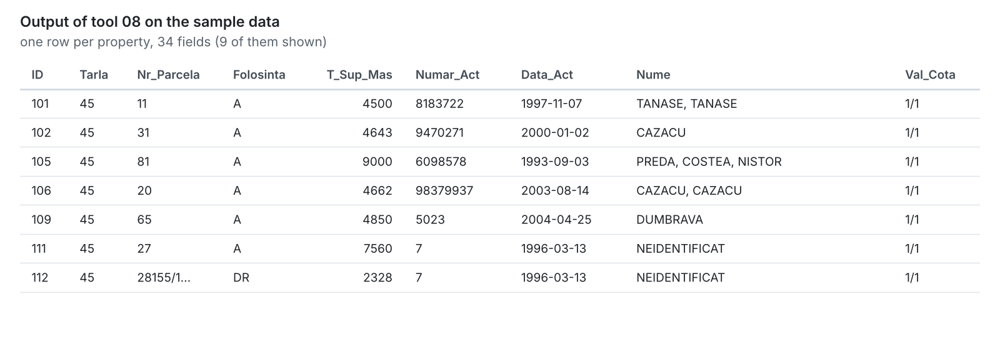
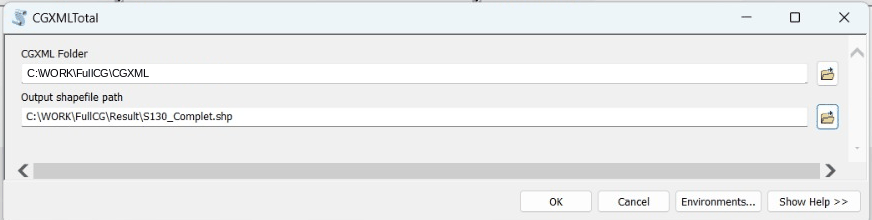

# 08 Generare CG CGXML attributes

The check for the legal data in files made with Generare CG. It reads parcels, deeds, owners, registrations and quotas from every file and puts them into one polygon layer, one row per property, ready to check against the documents before upload.

<picture>
  <source media="(prefers-color-scheme: dark)" srcset="../../docs/images/tool08_attributes-dark.png">
  
</picture>

**Files:** `Total.py` (script), `Full CG.tbx` (toolbox, tool name `CGXMLTotal`)

## Parameters

This is the tool in ArcMap:

| Parameter | What to give it |
|-----------|-----------------|
| CGXML Folder | Folder with the CGXML files made by Generare CG. |
| Output shapefile path | The new shapefile. |

## Fields in the output

Several values for one property are listed with commas, in the order of the file.

| Field | Content | Field | Content |
|-------|---------|-------|---------|
| SIRSUP | Administrative unit code | IdPersAdr | Address ID of each person |
| ID | CADGEN number | Prenume | First names |
| SECTOR | Cadastral sector | Nume | Last names |
| IntrExtr | True if any parcel is intravilan | Mort | Deceased |
| Obs_Imobil | Property notes | Identif | Identified |
| Nr_Parcela | Parcel numbers | CNP | Personal ID numbers |
| Tarla | Tarla numbers | Obs_Pers | Notes on persons |
| Folosinta | Use categories | ID_Regis | Registration IDs |
| T_Sup_Mas | Measured area | Tip_Regis | Registration types |
| T_Sup_Act | Area in the documents | DreptRegis | Rights registered |
| Act_ID | Deed IDs | Com_Regis | Right comments |
| Numar_Act | Deed numbers | Act_Reg | Deed ID of each registration |
| Data_Act | Deed dates | Titlu_Reg | Registration titles |
| Tip_Act | Deed types | Tip_Cota | Quota types |
| Autoritate | Issuing authorities | Val_Cota | Quota values |
| Obs_Act | Deed notes | Com_Cota | Quota comments |
| ID_Person | Person IDs | CF | e-Terra ID (E2IDENTIFIER), when the property already has one |

The script runs on Python 2 (ArcMap) and Python 3. It warns about duplicate IDs and properties without geometry.

## Try it

Run it on `sample_data/generare_cg_cgxml`. You get one layer with 13 properties.
