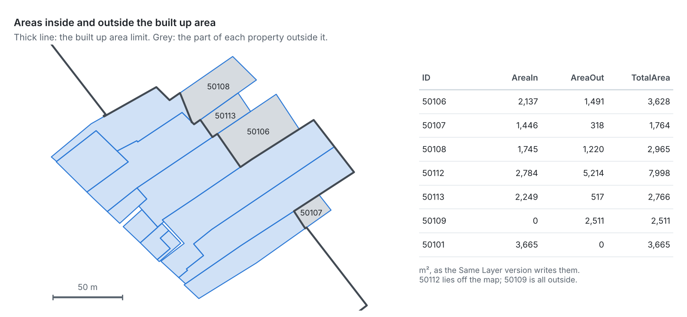
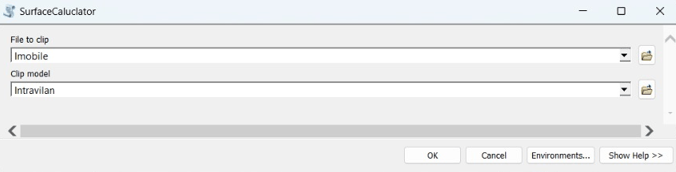

# 09 Surface calculator

The final technical report needs, for every property, the area inside the built up area (intravilan) and the area outside it. This tool calculates both in one run. There are two versions.

<picture>
  <source media="(prefers-color-scheme: dark)" srcset="../../docs/images/tool09_surface_calculator-dark.png">
  
</picture>

**Files:** `Surface Calculator (Same Layer).py`, `Surface Calculator (Multiple Output).py`, `Surface Calculator.tbx` (toolbox, tool name `SurfaceCaluclator`, which runs the Same Layer version)

## Same Layer version

Adds three fields to the property layer: `AreaIn`, `AreaOut` and `TotalArea`, in square meters.

| Parameter | What to give it |
|-----------|-----------------|
| File to clip | The property layer. **It is changed in place, so work on a copy.** |
| Clip model | The polygon of the built up area limit. |

## Multiple Output version

Creates two new shapefiles in a folder you choose: `Inside_Output.shp` and `Outside_Output.shp`, each with an `Area_sqm` field. It also prints the total area inside and outside the limit.

This version is not in the toolbox. To use it, right click the toolbox, choose **Add > Script**, select the script and give it three parameters in this order: the property layer (Feature Layer), the limit (Feature Layer) and the output folder (Folder).

## Notes

* The outside part is made with the Erase tool, which in ArcMap needs an ArcGIS Desktop Advanced license.
* Areas come from the layer's coordinate system, so use a projected system such as Stereo 70.

## Try it

Use `sample_data/shapefiles/Land.shp` (or a copy of it) with `sample_data/shapefiles/Intravilan_limit.shp`. The limit cuts through 5 of the 13 properties and leaves 50109 fully outside.
