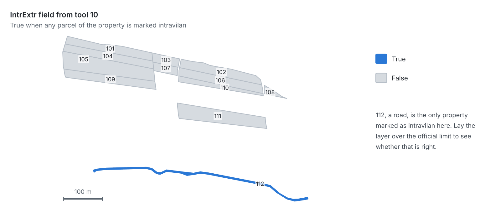

# 10 Intravilan check

Every parcel in a CGXML file is marked as inside or outside the built up area (intravilan). A wrong mark is easy to miss in the files and easy to see on a map. This tool builds one layer of all properties from Generare CG files, with a field that says whether a property has any parcel marked as intravilan. Lay it over the official built up area limit to spot mistakes before upload.

<picture>
  <source media="(prefers-color-scheme: dark)" srcset="../../docs/images/tool10_intravilan_check-dark.png">
  
</picture>

**Files:** `Intra_Extra.py` (script), `Intra_Extra.tbx` (toolbox, tool name `IntraExtra`)

## Parameters

| Parameter | What to give it |
|-----------|-----------------|
| CGXML Files Path | Folder with the CGXML files made by Generare CG. |
| Output path | The new shapefile. |

## Output

One polygon layer with `SIRSUP`, `ID` (CADGEN number), `SECTOR` and `IntrExtr` (`True` when at least one parcel of the property is intravilan, `False` otherwise).

## Try it

Run it on `sample_data/generare_cg_cgxml`.
