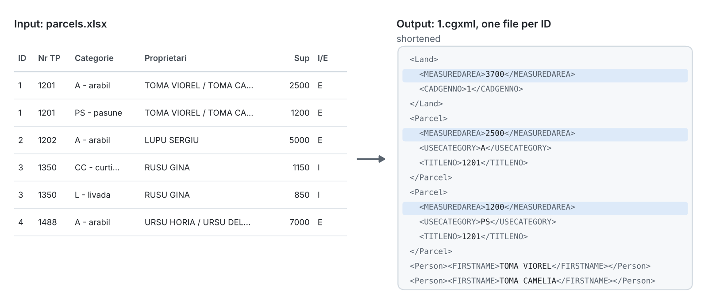

# 11 Generate CGXML from Excel

Creates draft CGXML files straight from a parcel table, for example a list of property titles exported from a database. Every group of rows with the same ID becomes one CGXML file with one parcel per row, its owners, the title and a registration. Geometry is added later in Generare CG.

<picture>
  <source media="(prefers-color-scheme: dark)" srcset="../../docs/images/tool11_excel_to_cgxml-dark.png">
  
</picture>

**File:** `Generare CG DIN Excel.py` (plain Python 3, no ArcGIS needed)

## The Excel table

| Column | Content |
|--------|---------|
| ID | Groups rows into one property. Becomes the file name and CADGEN number. |
| Nr TP | Property title number. |
| Data TP | Title date. |
| Categorie | Use category. Only the code before ` - ` is kept, so `A - arabil` becomes `A`. |
| Proprietari | Owners, separated by ` / `. |
| Sup parcela | Parcel area. The property area is the sum of its parcels. |
| Intra/Extravilan | `I` for intravilan, `E` for extravilan. |
| Tarla | Optional. Tarla number. |
| Parcela | Optional. Parcel number. |

Tip: to give every title and tarla pair its own ID, sort the table by title number and tarla, give the first row ID 1, and let every next row keep the ID of the row above when both values match, or add 1 when they do not.

## How to run

1. Install the packages once: `pip install pandas openpyxl lxml`
2. Open the script and set the Excel file path, the sheet name and the output folder at the top.
3. Check the fixed values in the script and change them for your area: the administrative unit codes (`SIRSUP`, `SIRUTA`), the issuing authority, the deed type and the registration details.
4. Run the script. It prints every ID it processes and writes `<ID>.cgxml` files into the output folder.

## Try it

Use `sample_data/excel_to_cgxml/parcels.xlsx` with the sheet name `Export Worksheet`. You get 4 CGXML files.
